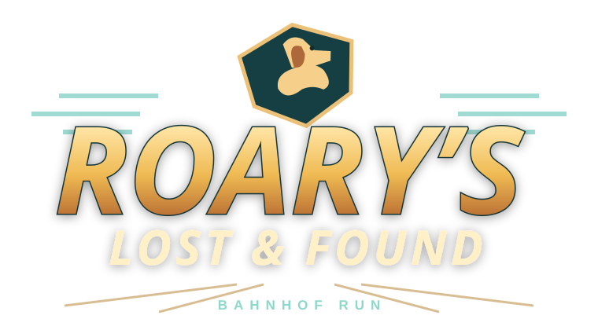

# Roary’s Lost & Found — Bahnhof Run

**[Jetzt im Browser spielen](https://flauschelin.github.io/roarys-lost-and-found-playtest/)**

Reines 3D-Actionspiel mit drei Bahnhofsläufen. Auf dem iPhone den Link in Safari
öffnen und SPIELEN antippen oder direkt Level 1, 2 oder 3 auswählen.
Kein Fundbüro, keine Point-and-Click-Rätsel, keine Textleisten oder Sprachuntertitel.
Die Sprachausgabe bleibt hörbar. Punkte und Leben liegen transparent über der Szene.

Die neue Bahnhof-Actionmusik „Gleiswechsel“, „Hallenjagd“ und „Letzter Zug“
nutzt drei Ausschnitte aus zwei eigens mit Suno v6 erzeugten Instrumentalstücken:
Schienenrhythmus, Percussion, Bass, Streicher und Bläsermotive. Die Musik wird
während Roarys Sprache abgesenkt. Die Opus-Downloads wurden für iPhone-Safari
in AAC umgewandelt.

Level 1 startet jetzt deutlich schneller und beschleunigt früher bis zum
Höchsttempo. Die Hindernisse und Abzweigungen bleiben an festen Positionen.
Roary läuft im Bild etwas höher, damit seine Bodenspuren sichtbar sind. Zwei
rote Herzen pro Level und jede Raucherpause geben ein zusätzliches Leben
(höchstens fünf). Die Ziellinie beendet den Lauf aus jeder Spur; Fundstücke
bringen Punkte, sind aber keine Pflicht für den Levelabschluss.

## Steuerung im Bahnhofslauf

- Gerät nach links/rechts neigen: Spur wechseln.
- Nach links/rechts wischen: an den T-Abzweigungen um 90° abbiegen.
- Nach oben wischen: springen.
- Nach unten wischen: ducken. Auf dem Skateboard ist Ducken gesperrt.
- Am Computer: A/D oder Pfeiltasten für Spuren, Q/E zum Abbiegen, Leertaste zum Springen, Escape für Pause.
- Beim ersten mobilen Start Sensorfreigabe erlauben und das Gerät kurz ruhig halten.
  Ohne Sensordaten lässt sich die Spur durch Tippen ins linke/mittlere/rechte Drittel wählen.
  Steuerung und Kalibrierung sind in der Pause einstellbar.
- Das kleine Pausensymbol öffnet Fortsetzen, Neustart, Steuerung und die Toneinstellungen.

Rekorde und Toneinstellungen werden lokal im jeweiligen Browser gespeichert. Beim Wechsel
zwischen Browsern oder Geräten wird der Spielstand nicht übertragen.

## Feedback

Feedback gern als [GitHub-Issue](https://github.com/Flauschelin/roarys-lost-and-found-playtest/issues/new).
Hilfreich sind iPhone-Modell, iOS-Version, betroffenes Level und eine
kurze Beschreibung; bei Darstellungsfehlern gern ein Screenshot.

Dies ist eine Testversion. Spielspaß, Schwierigkeit und Verhalten auf echten
iPhones werden noch geprüft.

## Dateien und Rechte

Dieses Repository enthält die fertig gebaute Webversion. Mitwirkende und
Lizenzhinweise stehen auf der [Lizenzseite](https://flauschelin.github.io/roarys-lost-and-found-playtest/licenses/).
Die MIT-Lizenz von Three.js gilt für Three.js; Modelle, Stimmen und Musik haben
ihre eigenen auf der Lizenzseite genannten Bedingungen.
